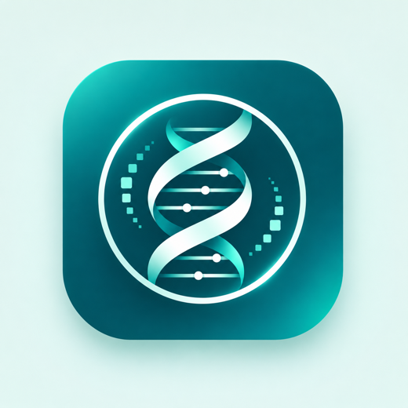
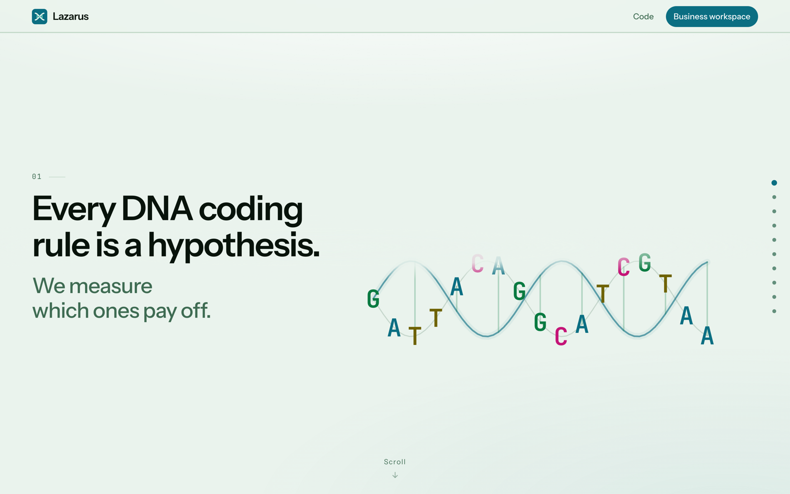
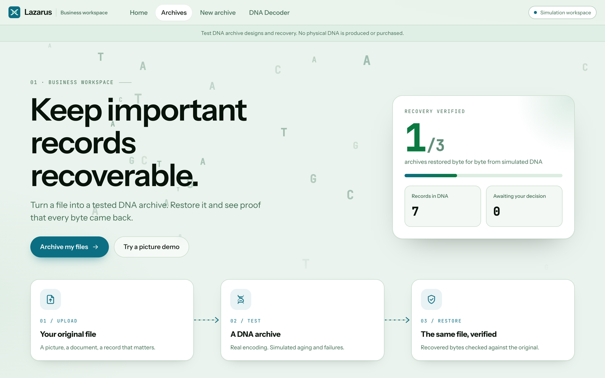
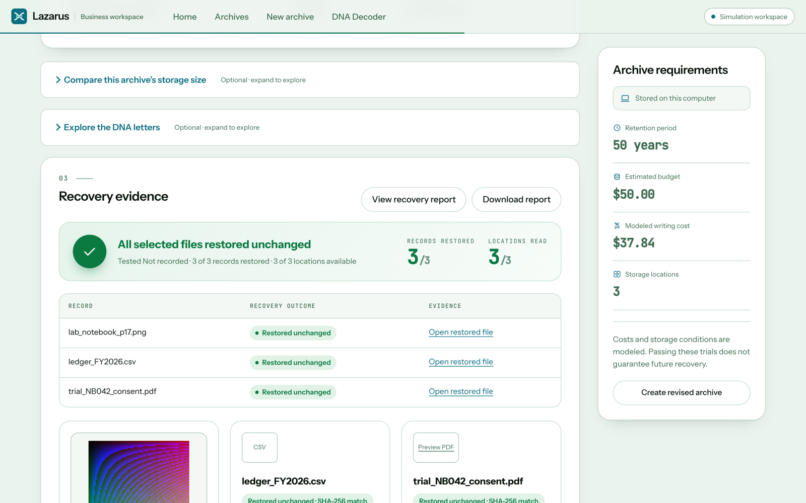
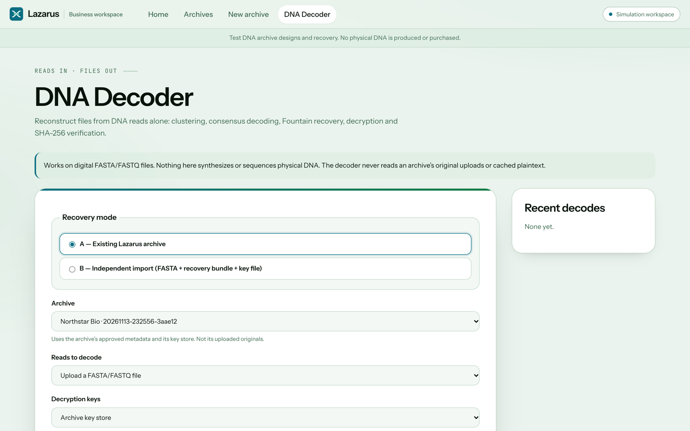
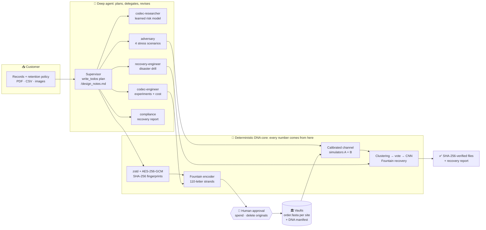

<div align="center">



<h1>Lazarus</h1>

<h3>An AI engineer that writes your company's records into DNA, then proves it can read them back</h3>

<p><em>A LangChain deep agent designs a DNA archive for files that must survive for decades, attacks its own design until it holds, stops for a human before spending money or deleting anything, and proves recovery byte for byte with SHA-256.</em></p>

<br />


<br /><br />


<br />


<br />


<br /><br />

🧬 Built at <b>HackPrinceton Fall 2026</b> · Princeton University · Business &amp; Enterprise · Best use of deepagents by LangChain

<br />

<a href="docs/DEEPAGENTS_DEMO.md"><b>Judge demo</b></a> ·
<a href="docs/HOW_IT_WORKS.md"><b>How it works</b></a> ·
<a href="docs/ENCODER_DECODER_DEEP_DIVE.md"><b>Encoder &amp; decoder deep dive</b></a> ·
<a href="docs/BIOLOGY.md"><b>DNA from zero</b></a> ·
<a href="docs/BOOTSTRAP.md"><b>Bootstrap spec</b></a>

</div>

---

## 🧬 Overview

Some records have to outlive the systems that store them. Clinical-trial files, bank records, legal
holds and media masters must stay readable for 25 years or more, while disks and tapes need replacing
every few years. DNA is the densest, longest-lasting storage medium known, but it is noisy, and no
normal company knows how to design a DNA archive or prove it can be read back.

**Lazarus is the engineer they don't have.** Upload your files and your retention policy. A team of
AI agents designs the archive, measures it, tries to break it, asks you to approve the cost, writes
vendor-ready DNA synthesis orders across several vault sites, then deletes the working copies and
proves it can rebuild every file from DNA alone.

> **Agents design. The DNA decides.** The LLM never writes a DNA letter and never invents a number.
> Every recovery rate, cost and verdict comes from a tool that runs the real DNA codec, and success
> means a byte-exact SHA-256 match. Nothing less counts.

1. **Triage.** The supervisor inventories the files and plans the job with `write_todos`.
2. **Seal.** Each file is compressed (zstd) and encrypted (AES-256-GCM). The key stays in the
   customer's key store; the DNA only ever holds a key id.
3. **Design.** The codec engineer runs real encode → simulate → decode experiments and finds the
   cheapest design that meets the recovery target.
4. **Attack.** The adversary hits that design with a lost vault site, a different sequencer, twice the
   storage time and 40% fewer reads. Any failure sends it back for a redesign and a full retest.
5. **Approve and write.** A human approves the modeled cost. Lazarus writes `order.fasta` files per
   vault, plus a self-describing manifest stored in the DNA itself.
6. **Prove.** After a second approval the working copies are deleted. The recovery engineer rebuilds
   every file from the surviving vaults, checks SHA-256, and the compliance agent writes the report.

All DNA here is digital: nothing is synthesized, sequenced or purchased. The sequencing channel is
calibrated on real Nanopore reads; storage decay and costs are modeled and labeled that way.

---

## 💸 Why it matters

Enterprises pay every year to keep power, cooling and floor space running for data almost nobody
touches, and pay again every few years to copy it onto the next generation of hardware.

| The number | Why it hurts |
|---|---|
| **~218 ZB** of data generated worldwide in 2025 ([IDC](https://www.idc.com/resource-center/definitions/what-are-the-global-datasphere-and-global-storagesphere/)) | The pile only grows, and every byte kept on disk needs powered, cooled hardware. |
| **415 TWh** used by data centres in 2024, about **1.5%** of the world's electricity, heading to **~945 TWh by 2030** ([IEA](https://www.iea.org/reports/energy-and-ai/executive-summary)) | Storage that sits idle still draws power and occupies racks. |
| **74.6%** of enterprise data already sits in warm, cool or cold tiers, and **over 60%** of data-lake volume is cold or rarely accessed ([IDC survey of 763 IT leaders, 2026](https://www.westerndigital.com/en-ua/company/newsroom/press-releases/2026/2026-09-09-wd-new-research-reveals-the-reshaping-of-ai-infrastructure-economics-as-data-persists-and-compounds), sponsored by Western Digital) | Most stored data is archive data. It does not need a spinning disk. |
| **25 years** minimum retention for EU clinical-trial master files, on media that must stay complete and legible for the whole period ([EU 536/2014, Art. 58](https://eur-lex.europa.eu/eli/reg/2014/536/oj)) | That outlives several generations of disks and tapes. |
| Since **LTO-8**, tape drives read only **one generation back** ([LTO migration overview](https://wasabi.com/blog/data-management/lto-tape-data-migration-to-cloud-storage)) | Long archives must be re-copied again and again just to stay readable. |

**DNA changes the math.** It has been written at **215 petabytes per gram**
([Erlich & Zielinski, *Science* 2017](https://pubmed.ncbi.nlm.nih.gov/28254941/)), and readable DNA has
been recovered from **two-million-year-old** sediment ([Kjær et al., *Nature* 2022](https://www.nature.com/articles/s41586-022-05453-y)).
At that density, 1 TB is about **4.65 mg** of DNA material, and the world's entire 2025 data output
would be about **one tonne, roughly one cubic metre** (a modeled extrapolation, the same math as the
app's storage scale explorer). Stored cool and dry, it needs no power and never needs migrating: DNA
is the one format people will always know how to read.

**What stops companies today is not the chemistry. It is the engineering and the proof.** That is
exactly what Lazarus does.

---

## ✨ Highlights

| | |
|---|---|
| 🤖 **Deep agent engineer** | A supervisor plans with `write_todos` and delegates to five specialist subagents, each with its own context, prompt and tools. |
| 🧬 **Real DNA codec** | Fountain-coded 110-letter strands with a checksum on every strand and chemistry rules built in (no runs of 4+ identical letters, 40–60% GC). |
| 🧠 **CNN decoder** | A 0.8M-parameter network corrects the classic majority vote: **82.3% vs 67.2%** exact strands at 6 reads on held-out real Nanopore data. |
| 🛡️ **Red team built in** | Every design is attacked: lost vault site, a structurally different sequencer, twice the storage time, 40% fewer reads. |
| 👤 **Human gates** | Spending money and destroying originals both pause for explicit approval (`interrupt_on`). Approve, edit or reject. |
| 🔐 **Key never in DNA** | zstd + AES-256-GCM. Stolen DNA is unreadable ciphertext; a single flipped bit fails the GCM tag. |
| 📜 **Self-describing archive** | The manifest is written into DNA with one fixed, published setting. In 50 years a one-page spec is enough to start reading. |
| 🏛️ **Multi-vault placement** | Strand *i* goes to vault *i* mod *n*, every vault holds a full manifest copy, and orders are vendor-ready FASTA and CSV. |
| 🔬 **Independent decoder** | FASTA/FASTQ in (gzip, quality filtering, reverse-strand reads), SHA-256-verified files out, even on a machine with no copy of the archive. |
| 🗝️ **One key, decades later** | Each organization keeps a single master key backup. Per-file keys are wrapped under it, and rotation never touches the DNA. |
| 📦 **Recovery Package** | One ZIP per archive with everything needed to recover it offline: manifest, codec settings, sample sheet, synthesis files and the decoder itself. |
| 📏 **Storage scale explorer** | See your exact file as printed paper, hard drives and DNA, from a single file to the world's annual data. |

---

## 📸 Screenshots

<table>
  <tr>
    <td width="50%"></td>
    <td width="50%"></td>
  </tr>
  <tr>
    <td align="center"><b>Homepage.</b> A scrolling story of how DNA archives are written, damaged and recovered.</td>
    <td align="center"><b>Business workspace.</b> Every archive, its recovery status, and the upload → test → restore journey.</td>
  </tr>
  <tr>
    <td width="50%"></td>
    <td width="50%"></td>
  </tr>
  <tr>
    <td align="center"><b>Recovery evidence.</b> 3 of 3 records rebuilt from DNA after 50 simulated years, each with a SHA-256 match.</td>
    <td align="center"><b>DNA Decoder.</b> Reads in, verified files out: clustering, consensus, Fountain recovery, decryption.</td>
  </tr>
</table>

---

## 🏗️ Architecture



**Agents never touch the bytes.** The deep agent decides *what to test*; deterministic code decides
*what is true*. LLM output only reaches the DNA as validated tool arguments, and only after a human
says yes.

<details>
<summary><b>Life of one archive</b></summary>

1. `inventory_files`: size, type and SHA-256 of every upload, plus the retention policy.
2. `prepare_archive`: compress, encrypt, join into one stream, split into balanced pools of ≤ 12 KB.
3. **codec-researcher** → `prepare_learned_model`: optionally trains a risk model that predicts which
   strands the decoder will get wrong on this customer's channel.
4. **codec-engineer** → sweeps and experiments: real encode → simulated sequencing → decode → recover,
   across redundancy and coverage, then `estimate_cost`.
5. **adversary** → `stress_test` × 4 on the whole archive. Any failure: the supervisor raises
   redundancy or coverage and the adversary reruns **all four** scenarios on the new design.
6. The decision and its evidence go into `/design_notes.md` in the agent's virtual filesystem.
7. `place_synthesis_order` **pauses for human approval**, then writes `order.fasta` and `order.csv`
   per vault and the DNA-encoded manifest.
8. `destroy_primary` **pauses for human approval**, then deletes the working originals.
9. **recovery-engineer** → `recover_archive`: reads the surviving vaults, decodes the manifest with the
   bootstrap spec, decodes every pool with the classic decoder and the CNN, decrypts, checks SHA-256.
10. **compliance** → `read_job_log` + `write_certificate`: a report that states only facts in the log.

</details>

<details>
<summary><b>The DNA format, in one screen</b></summary>

```
|<-- 16 letters -->|<-------------------- 94 letters -------------------->|
|   seed (32 bits) |  172 bits of XOR-mixed data  +  CRC-16, whitened      |
```

- **Fountain code.** Each strand carries the XOR of a few data chunks chosen by its seed. Any large
  enough subset of strands rebuilds the pool, so lost strands are fine.
- **Checksums at three levels.** CRC-16 per strand, CRC-32 per pool, SHA-256 per file. A wrong strand
  is thrown away instead of corrupting the file.
- **Chemistry rules for free.** A strand that breaks a rule is replaced by the next seed's strand,
  which costs no density.
- **Bootstrap manifest.** 4,096 bytes, 382 strands, a full copy in every vault, written with one
  published setting so a future reader can always start.

Every step, explained from zero: [encoder & decoder deep dive](docs/ENCODER_DECODER_DEEP_DIVE.md).

</details>

<details>
<summary><b>Verdicts</b></summary>

| Verdict | Meaning |
|---|---|
| **PASS** | Every expected file was rebuilt and its SHA-256 matches. |
| **PARTIAL** | Some files match, others don't. The report says which and why. |
| **FAIL** | No file matches. Similar-looking DNA never counts as recovery. |
| **INCOMPLETE** | Something required was missing (manifest, key, decoder). The report names it. |

</details>

---

## 🤖 Why deep agents

Designing a DNA archive is not a question you can answer in one prompt. It is a long engineering job:
dozens of measurements, dead ends, trade-offs between cost and safety, and two decisions you cannot
undo. That is exactly the shape of work LangChain's **deepagents** was built for, and it is why Lazarus
is a deep agent and not a chatbot.

- **It plans like an engineer.** The supervisor writes the job as a todo list with `write_todos` and
  keeps it updated. The workspace streams that plan live, so you watch the work happen.
- **It hires specialists.** Five subagents, each with its own context window, prompt and tool set. The
  codec engineer never sees recovery noise; the adversary never sees the engineer's hopes.
- **It argues with itself.** The engineer proposes the cheapest design. The adversary's only job is to
  break it. A failure forces a redesign, and every new design must pass all four attacks again:
  results from an older design never count.
- **It keeps its reasoning on file.** Design decisions and evidence are written to `/design_notes.md`
  and `/learning-evidence.md` in the agent's virtual filesystem, next to a full custody log.
- **It stops where humans must decide.** `interrupt_on` pauses before spending money
  (`place_synthesis_order`) and before destroying data (`destroy_primary`). You can approve, edit the
  arguments or reject, and LangGraph's checkpointer resumes exactly where it stopped.
- **It cannot make things up.** The model never writes DNA letters or numbers. Every claim is a tool
  result from the real codec, and the compliance agent may only state facts found in the log.

| | One LLM call | Lazarus deep agent |
|---|---|---|
| Multi-step plan | ✗ | `write_todos`, visible live |
| Real experiments | ✗ | encode → simulate → decode via tools |
| Focused context | one overloaded prompt | isolated context per subagent |
| Catches its own bad design | ✗ | adversary + redesign loop |
| Safe with money and deletion | ✗ | `interrupt_on` approvals |
| Auditable afterwards | a chat log | design notes, custody log, verification report |

> Without the deep agent, Lazarus is a codec library an expert has to drive by hand for hours. With
> it, a compliance officer uploads files, answers two approval prompts, and gets a verified archive
> with an evidence trail.

The supervisor runs on **Gemini 2.5 Flash** when `GOOGLE_API_KEY` is set and on **Claude** when
`ANTHROPIC_API_KEY` is set. **Autopilot** runs the same tools on a fixed recipe with no LLM, clearly
labeled, for offline demos and as a control.

---

<a id="long-term-recovery"></a>

## 🗝️ Long-term recovery

A DNA archive is only useful if someone can still read it when Lazarus, its servers and its database
are long gone. So every archive can be recovered from three things: **the DNA reads, the archive's
Recovery Package and one master key backup.**

- **Organization master keys.** Each organization gets a versioned 256-bit master key. Every file still
  gets its own data key, stored only *wrapped* under the master key (AES-256-GCM, bound to the
  organization, archive, key id and version). The master key leaves the server only as a
  passphrase-protected backup (scrypt + AES-256-GCM).
- **Rotation and migration.** Rotating creates a new key version and re-wraps every archive's keys
  without touching the DNA. Migrating a legacy archive switches it over only after a full decode of
  its DNA with the wrapped keys passes.
- **Recovery Package** (`lazarus-recovery-package-v1.zip`, [spec](docs/RECOVERY_PACKAGE.md)). The
  manifest, file table, codec settings, sample sheet, clean and per-vault synthesis files, the offline
  decoder with a locked copy of the codec, and SHA256SUMS over everything. It never contains an
  unwrapped key, and any tampered or unlisted member is rejected.
- **Laboratory reads.** FASTQ (gzip allowed) with quality filtering (mean Phred below 7 is dropped),
  reads with ambiguous bases removed, and reverse-strand reads recognized by checking each consensus
  strand's checksum in both orientations. Reports separate *simulated reads*, *laboratory-format
  reads* and *physical recovery*, and state that physical recovery has not been demonstrated.

```bash
cd decoder && python -m venv .venv && .venv/bin/pip install -r requirements.lock
.venv/bin/python -m lazarus.offline_decode \
    --recovery-package ../lazarus-recovery-package-v1.zip \
    --reads-sheet lab_samples.csv \
    --master-key organization-master-key.json \
    --output ./recovered
```

Exit code 0 means PASS. The passphrase comes from a hidden prompt or an environment variable, never
the command line, and `--self-test` checks an install without any key. In this repo the same decoder
is installed as `uv run lazarus-decode`.

---

## 🚀 Quickstart

**Requirements:** Python 3.11–3.13, [uv](https://docs.astral.sh/uv/), Node 20+, git. API keys are
optional: without one, Autopilot runs the full pipeline offline.

```bash
git clone https://github.com/GravitB/dna.git && cd dna
cp .env.example .env      # optional: GOOGLE_API_KEY (Gemini) or ANTHROPIC_API_KEY (Claude)
scripts/run.sh            # checks the bundled codec, installs, builds the UI, serves on :8000
```

Open **http://localhost:8000** for the homepage and **http://localhost:8000/app/** for the business
workspace.

<details>
<summary><b>Try it in two minutes</b></summary>

1. In the workspace, choose **Try a picture demo**. It encodes a bundled 412-byte PNG with 50 simulated
   years, three vault sites and 16 planned reads per strand.
2. Select **Analyze archive** and watch the agents plan, measure and attack the design.
3. Review the evidence and modeled cost, then **Approve simulated archive**.
4. Select **Run recovery test**. The working copies are deleted and the picture is rebuilt from DNA.
5. Open the recovery evidence: every file shows its SHA-256 match.

Or choose **Create archive** to upload your own files (up to 200 KB), or **Try sample archive** for the
fictional Northstar Bio records.

</details>

<details>
<summary><b>Break it on purpose</b></summary>

On an approved archive, open the DNA experiment and simulate damage, then decode the damaged reads in
the **DNA Decoder**:

- **Destroy a vault site.** Its strands produce no reads at all.
- **Switch to Simulator B.** A structurally different sequencer with error bursts and chimera reads.
- **Double the storage years** or **cut the coverage.** More strands lost, fewer reads per strand.
- **Withhold a key.** The verdict becomes INCOMPLETE and names the missing key.

Lazarus reports a PASS only when every hash matches. Too much damage gives an honest PARTIAL or FAIL.

</details>

<details>
<summary><b>Decode on another machine</b></summary>

Download the archive's **Recovery Package** and your organization's master key backup, then decode
the reads anywhere: in the **DNA Decoder → Independent import**, or fully offline with the decoder
shipped inside the package (see [Long-term recovery](#long-term-recovery)). Legacy archives
use a passphrase-protected key file instead. The decoder never needs the original workspace.

</details>

<details>
<summary><b>Development and tests</b></summary>

```bash
cd lazarus && uv run uvicorn lazarus.api:app --reload --port 8000
cd web && npm run dev                      # http://localhost:5173/app/, proxies /api to :8000

cd lazarus && uv run pytest -q             # 99 tests
cd web && npx vitest run && npm run build  # 41 tests
```

The tests cover tamper detection, decoding the manifest from the bootstrap spec alone, corrupted
strands never producing wrong bytes, recovery from 2 of 3 vaults, independent decoding after the
workspace is deleted, and the full deep-agent graph with human approval, driven by a scripted model
so no API key is needed.

</details>

---

## 🎯 Lazarus in 10 answers

| | |
|---|---|
| **User and problem** | Records and compliance teams at pharma companies, banks, law firms and media archives who must keep files readable for 25+ years on media that wears out or goes obsolete within a decade. |
| **Core claim** | An archived file can be rebuilt byte for byte from DNA reads alone, with no original, no database and no remembered settings, or the decoder states exactly why not. |
| **Boundary** | Digital simulation: no DNA is made or read. Channel calibrated on real Nanopore reads; decay and costs modeled. Demo archives up to 200 KB; a local key folder stands in for a KMS or HSM. |
| **Correctness** | CRC-16 per strand, CRC-32 per pool, AES-GCM tag and SHA-256 per file. Recovery returns exact bytes or nothing. Design selection uses training seeds; final validation uses held-out seeds that cannot be re-rolled. |
| **Evidence** | 140 automated tests, plus per-archive recovery reports in JSON and HTML with every step, decoder and hash. |
| **Interfaces** | React workspace ⇄ FastAPI + live event stream ⇄ deep agent ⇄ tool layer ⇄ DNA codec. FASTA/FASTQ in; vendor-ready FASTA/CSV, Recovery Packages and verification reports out; `lazarus-decode` on the command line. |
| **Measurement** | Exact-strand accuracy on held-out real reads, recovery rate over simulated trials, modeled write and read cost, bits per DNA letter. |
| **Failure behavior** | Missing key ⇒ INCOMPLETE. Wrong key or flipped bit ⇒ GCM rejects. Failed stress test ⇒ redesign and full retest. Failed final held-out test ⇒ no order can be approved. Tampered Recovery Package ⇒ rejected before decoding. |
| **Reproduction** | The Quickstart above. Works offline with Autopilot. |
| **Next limit** | Physical recovery from synthesized DNA, adapter and primer trimming for lab reads, archives beyond 200 KB, a production KMS with user authentication, larger trial counts. |

---

## 📊 By the numbers

| Metric | Result |
|---|---|
| A single sequencing read exactly right | **1.1%** of strands |
| Exact strands at 6 reads, classic majority vote | **67.2%** |
| Exact strands at 6 reads, Lazarus's CNN decoder | **82.3%** (best research variant: 88.1%) |
| CNN decoder size | **0.8M** parameters, best checkpoint after ~10 minutes of training |
| Wrong strand slipping past its checksum | **1 in 65,536**, and the pool CRC-32 and file SHA-256 still catch it |
| Storage density (redundancy 0.3) | **1.2 bits per DNA letter**, 727 strands per 12 KB pool |
| Simulated vs real Nanopore decoding | within **~3 points** at every read depth |
| DNA material for 1 TB (215 PB/g benchmark) | **4.65 mg** |
| Sample archive (Northstar Bio) | **3 of 3** records restored byte-exact from 3 vaults after 50 simulated years |
| Automated tests | **140** (99 backend, 41 web) |

Decoder figures: 1,996 held-out real Nanopore strands never used for training, averaged over 20
random read draws per point. Archive results are simulation evidence, not a guarantee of future
physical recovery.

---

## 🗂️ Repository map

```
lazarus/
  lazarus/          ★ the product: deep agent, tools, API, decoder
    agent.py          deepagents supervisor + 5 subagents + human-in-the-loop runner
    tools.py          agent tools; every number comes from a real codec run
    autopilot.py      the same tools on a fixed recipe, no LLM
    crypto.py         zstd + AES-256-GCM + SHA-256, pool splitting
    manifest.py       self-describing DNA bootstrap manifest
    vaults.py         per-site FASTA/CSV synthesis orders, vault loss
    experiment.py     clean DNA export, reproducible damage simulations
    clustering.py     reference-free read clustering
    decoder.py        standalone decoder, verdicts, reports, key files
    offline_decode.py lazarus-decode, the offline command-line decoder
    orgkeys.py        master keys, envelope wrapping, passphrase-protected backups
    orgs.py           organizations: key custody, backup, restore, rotation, migration
    recovery_package.py  builds each archive's Long-Term Recovery Package
    package_format.py    Recovery Package reader/writer with integrity checks
    candidates.py     frozen designs, train-seed screening, held-out validation
    learned.py        learned (risk-model) encoding experiments
    api.py            FastAPI + live events; serves the homepage and workspace
  dna_codec/        bundled DNA codec: Fountain encoder, channel simulators, decoders
  checkpoints/      pre-trained CNN decoder
  profiles/         calibrated Nanopore and Illumina channel profiles
  tests/            99 backend tests
web/                React business workspace (/app): archives, wizard, decoder, 3D helix
site/               scrolling homepage (/)
supabase/           optional cloud storage migrations
sample_data/        fictional Northstar Bio records
scripts/            run, codec check, verification helpers
docs/               deep dives, bootstrap spec, demo script, screenshots
```

---

## 🧰 Built with

| Layer | Tools |
|---|---|
| Agents | LangChain deepagents, LangGraph (checkpointer, interrupts), Gemini 2.5 Flash, Claude |
| DNA | Fountain (LT) code with robust soliton degrees, calibrated sequencing simulators, majority-vote and CNN consensus |
| ML | PyTorch (CUDA, Apple MPS or CPU), rapidfuzz |
| Security | AES-256-GCM, scrypt key files, SHA-256, zstd |
| Backend | Python 3.11+, FastAPI, Uvicorn, server-sent events, uv |
| Storage | Local job store, or Supabase for cloud archives |
| Frontend | React 18, Vite 6, TypeScript, three.js, Recharts |
| Testing | pytest, Vitest, Playwright |

Built during HackPrinceton: everything under `lazarus/lazarus/`, `lazarus/tests/`, `web/`, `supabase/`,
`scripts/`, `sample_data/` and `docs/`. The DNA codec, channel simulators and pre-trained CNN decoder in
`lazarus/dna_codec/`, `lazarus/profiles/` and `lazarus/checkpoints/` are bundled with permission and
used unchanged, and the homepage in `site/` is adapted from the same project's site with permission.

---

## ⚖️ Honest by design

- DNA synthesis and sequencing are **simulated**. The channel is calibrated on real Nanopore reads;
  storage decay is extrapolated and always labeled "modeled".
- Costs use placeholder prices and are always labeled "modeled".
- Recovery rates come from small trial counts. One PASS is one trial, not a reliability guarantee.
- Recovery Packages have been tested on simulated and laboratory-format reads, never on reads from
  synthesized DNA, and the synthesis requirements have not been validated with a provider.
- This is a local demo, not a compliance certification. Master keys live in a local folder that
  simulates a KMS. Only organization key operations need a token; archive pages have no user
  authentication, so don't upload sensitive files or expose the server to a network.

---

## 📚 Docs

[How it works](docs/HOW_IT_WORKS.md) ·
[Encoder & decoder deep dive](docs/ENCODER_DECODER_DEEP_DIVE.md) ·
[DNA from zero](docs/BIOLOGY.md) ·
[Bootstrap spec](docs/BOOTSTRAP.md) ·
[Recovery Package spec](docs/RECOVERY_PACKAGE.md) ·
[Deep agents demo](docs/DEEPAGENTS_DEMO.md) ·
[Learned archives](docs/LEARNED_ARCHIVES.md) ·
[3D DNA viewer](docs/VISUAL_DNA.md) ·
[Cloud storage](docs/SUPABASE.md) ·
[Pitch](docs/PITCH.md)
